# 🎓 GRANTLY – Unified Scholarship Discovery & Management Platform

<div align="center">

[](https://vercel.com/)
[](https://react.dev/)
[](https://www.typescriptlang.org/)
[](https://tailwindcss.com/)
[](https://github.com/siribeesu/Unified-Scholarship-Discovery-Management-Platform)
[](https://github.com/siribeesu/Unified-Scholarship-Discovery-Management-Platform)
[](LICENSE)

### **"Your Future Deserves Funding. Find It Here."**
*A production-grade, next-generation EdTech platform simplifying how students discover, evaluate eligibility, compare, apply for, and track scholarships across Government, Corporate CSR, and International bodies.*

[Explore Platform](#-interactive-platform-features) • [Deployment Guide](#-deploying-to-vercel) • [Algorithms & Math](#-rule-engine--mathematical-models) • [Local Setup](#-local-installation--quick-start)

---

</div>

## 📖 Executive Summary & Product Vision

Every academic year, billions of dollars in higher education funding go unclaimed or underutilized. The core barrier is not a lack of student ambition—it is structural information asymmetry:
1. **Scattered Portals**: Information is dispersed across central government portals (NSP, AICTE), state DBT registries, corporate foundations, and foreign exchange databases.
2. **Obtuse Eligibility Criteria**: Criteria documents are often 40-page PDFs filled with legal jargon, making it nearly impossible for students to verify if their exact family income bracket or semester backlogs disqualify them.
3. **Missed Deadlines & Document Anxiety**: Applying requires 6–10 official certificates (bonafide letters, revenue tehsildar income certificates, caste declarations, bank passbooks) with independent expiration dates.
4. **Disorganized Application Management**: Tracking multiple opportunities across sticky notes and spreadsheets leads to lost reference numbers and missed shortlist notifications.

**GRANTLY** solves this end-to-end through a unified six-stage framework:

$$\text{\bfseries Discover} \longrightarrow \text{\bfseries Check Eligibility} \longrightarrow \text{\bfseries Compare} \longrightarrow \text{\bfseries Apply} \longrightarrow \text{\bfseries Track} \longrightarrow \text{\bfseries Succeed}$$

Built with the design language and reliability of a modern enterprise EdTech SaaS, GRANTLY serves undergraduate, postgraduate, PhD, technical degree, minority, and economically challenged students worldwide.

---

## 🏛️ System Architecture

```mermaid
flowchart TD
    subgraph UI_Layer["🖥️ Frontend & UX Presentation Layer"]
        A["Landing Page & Hero Showcase"]
        B["Student Onboarding Wizard (4 Steps)"]
        C["SaaS Dashboard & Financial Impact"]
        D["Multi-Faceted Scholarship Discovery"]
        E["Side-by-Side Comparison Matrix (4-Way)"]
        F["Interactive Kanban Application Tracker"]
        G["Document Vault & Expiry Radar"]
        H["Deadline Calendar & Urgent Alert Strip"]
    end

    subgraph Logic_Layer["⚙️ Core Business Engines (Deterministic)"]
        I["Rule-Based Eligibility Engine<br/>(CGPA, Income, Category, Domicile, Gender)"]
        J["Opportunity Scoring Algorithm<br/>(50% Compatibility + 30% Value + 20% Urgency)"]
        K["Missing Document Detector<br/>(Cross-referencing Vault against Tracked Requirements)"]
        L["What-If Scenario Simulator<br/>(Real-Time Profile Parameter Perturbation)"]
    end

    subgraph State_Layer["💾 State & Persistence Management"]
        M["React Context Engine (AppContext)"]
        N["LocalStorage Auto-Sync & Versioned Storage"]
        O["Pre-Seeded Multi-Demographic Demo Personas"]
        P["JSON Data Portability (Export/Import)"]
    end

    subgraph Data_Layer["📚 Verified Scholarship Database"]
        Q["Indian Central Govt (NSP, AICTE, DST INSPIRE)"]
        R["Indian State Schemes (MahaDBT, State Quotas)"]
        S["Corporate CSR Foundations (Tata, Reliance, Infosys, HDFC, ONGC)"]
        T["International Fellowships (Fulbright-Nehru, DAAD Germany)"]
    end

    UI_Layer <--> Logic_Layer
    Logic_Layer <--> State_Layer
    State_Layer <--> Data_Layer
```



---

## 🚀 Interactive Platform Features (14 Unified Views)

### 1. High-Converting Landing Page Experience
* **Hero Heading**: *"Your Future Deserves Funding. Find It Here."*
* **Interactive Live Preview**: Real-time mock dashboard preview showcasing live metrics before registration.
* **3-Step How It Works**: 1) Profile Build, 2) Match & Gap Analysis, 3) Kanban Tracking to Grant Approval.
* **Featured Opportunities Grid**: Direct preview cards linking into detailed view modals.
* **Student Success Stories**: Illustrative peer journeys illustrating how specific students unlocked grants.
* **Interactive FAQ Accordion**: Clear explanations on transparency, verification, and zero fees.

### 2. Authentication & Demo Personas
* Modern login and registration interfaces with instant field validation and password masking toggles.
* **1-Click Demo Persona Switcher**: Test the app instantly without registering by clicking pre-configured personas:
  * **Priya Sharma**: B.Tech CSE (3rd Year), CGPA 8.8, Family Income ₹3.2 LPA, OBC Category, Female (Pune, Maharashtra).
  * **Rahul Verma**: M.Sc Biotechnology (1st Year), CGPA 7.6, Family Income ₹1.8 LPA, SC Category, Male (IIT Delhi).
  * **Ananya Sen**: B.A. Economics (2nd Year), CGPA 9.2, Family Income ₹6.5 LPA, General Category, Female (Kolkata).

### 3. Student Profile Onboarding (4 Steps)
* **Step 1: Academic Degree**: Education level (Undergraduate, Postgraduate, High School, PhD), degree title, branch, and current year (1–5).
* **Step 2: Academic Merit**: Continuous CGPA slider (4.0 to 10.0 scale) and percentage equivalence, institution name, and state domicile.
* **Step 3: Socio-Economic Profile**: Annual family income slider with instant Lakhs Per Annum (LPA) feedback, category quotas (General, OBC, SC, ST, EWS, Minority), and gender declaration.
* **Step 4: Funding Preferences**: Preferred scheme types (Central Govt, State Govt, CSR, International) and first-generation learner tagging.

### 4. Personalized Dashboard & Financial Impact Overview
* **Financial Impact Metrics**:
  * **Total Potential Funding**: Cumulative funds unlocked across all matching schemes ($\approx \text{\rupee} 4,25,000+$).
  * **Applications In-Pipeline**: Total funding currently submitted and under review.
  * **Awarded / Disbursed Grants**: Direct Benefit Transfer (DBT) confirmed funding.
* **Recharts Application Pipeline**: Visual distribution bar chart tracking stage progression.
* **Urgent Deadline Alert Strip**: Highlights any scholarship closing within $\le 14$ days.
* **Document Vault Readiness Alert**: Instant notification of missing certificates required for saved applications.

### 5. Smart Scholarship Discovery
* **Deep Search**: Instant full-text search indexing title, organization, description, and keywords.
* **Multi-Faceted Filter Matrix**:
  * *Provider Type*: Central Government, State Government, Private/CSR, International.
  * *Funding Basis*: Merit-based, Need-based, Merit-cum-Means, Special/Reserved.
  * *Education Level*: High School, Undergraduate, Postgraduate, Diploma.
  * *Funding Tiers*: Up to ₹50,000, ₹50,000–₹1,50,000, ₹1,50,000+.
  * *Urgency*: Closing in 14 days, Next 30 days, Next 90 days.
* **Smart Sorting**: Opportunity Score (Default), Match Percentage, Highest Funding Amount, and Nearest Deadline.
* **Quick Actions**: Add to Tracker, 1-Click Comparison Checkbox, and Bookmark toggle.

### 6. Detailed Scholarship Information & Verification Page
* Comprehensive information card detailing total seats, annual renewal conditions, and provider background.
* **Itemized Eligibility Verification**: Compares the student's exact profile values against the scholarship's cutoff criteria with transparent checkmarks ($\checkmark$) or rejection crosses ($\times$).
* **Application Readiness Checklist**: Automatically verifies which documents are present in the student's Document Vault vs what is still missing.
* **Official Source Links**: Direct hyperlinks to verified authority domains (e.g., `scholarships.gov.in`, `tatatrusts.org`, `daad.de`).

### 7. Smart Eligibility Checker & What-If Simulator
* Dedicated testing suite for evaluating qualification rules across any scholarship.
* **What-If Scenario Simulator**: Real-time sliders allowing students to simulate:
  * *"What if I improve my CGPA from 7.2 to 8.5 next semester?"*
  * *"What if my certified family income decreases from ₹4 LPA to ₹2 LPA?"*
  * Instant recalculation of all match scores and newly unlocked grants without altering the student's permanent profile.

### 8. Side-by-Side Scholarship Comparison Matrix
* Side-by-side comparative table supporting up to 4 selected opportunities simultaneously.
* Evaluates: Opportunity Score, Total Grant Value, Application Deadline, Academic Cutoffs, Family Income Ceilings, Eligible Branches, and Required Documents.

### 9. Visual 7-Stage Kanban Application Tracker
* Drag-and-drop or status-select Kanban board across seven lifecycle stages:
  1. `Interested` – Saved for future consideration.
  2. `Preparing` – Gathering mandatory certificates and drafting statements.
  3. `Applied` – Formally submitted on the official portal; logs official reference numbers.
  4. `Under Review` – Pending scrutiny by institutional verification officers.
  5. `Shortlisted` – Selected for merit interview or document physical verification.
  6. `Approved` – Grant sanctioned! Triggers celebratory confetti particle animation.
  7. `Rejected` – Opportunity archived for analysis.
* Full note-taking modal to record reminders, follow-ups, and reference IDs.

### 10. Secure Document Vault & Expiry Radar
* Centralized digital organizer for standard student credentials:
  * Aadhaar Card (Identity)
  * Income Certificate (with annual March 31st financial year expiry tracking)
  * Community / Caste Certificate (OBC-NCL / SC / ST validity)
  * Previous Semester Academic Marksheets & Transcripts
  * College Bonafide Student Certificate
  * Aadhaar-Seeded Bank Passbook Copy
  * Passport / Visa Documents (for international candidates)
* **Missing Document Radar**: Aggregates all missing documents across scholarships in `Interested` and `Preparing` statuses and provides 1-click upload paths.

### 11. Interactive Deadline Calendar
* Full month-by-month calendar view (November & December 2026).
* Color-coded day cells indicating closing grants with tooltip details.
* **Critical 7-Day Expiry Banner**: High-priority alert highlighting schemes with imminent deadlines.

### 12. Student Profile Management & Instant Recalculation
* Full profile editor for personal, academic, socioeconomic, and preference data.
* Saving profile updates immediately triggers a re-evaluation across all scholarships in the background.

### 13. Platform Settings & Data Portability
* Toggle granular email and browser notification preferences.
* **JSON Data Export**: Allows students to download their entire profile, vault index, and tracker state as a single JSON file.
* **Demo Factory Reset**: Restores all trackers, documents, and profiles to clean initial demonstration states.

---

## 🧮 Rule Engine & Mathematical Models

### 1. Deterministic Eligibility Matching Engine

The eligibility match score $M \in [0, 100]$ is computed deterministically across four weighted criteria:

$$M = W_{\text{edu}} \cdot S_{\text{edu}} + W_{\text{merit}} \cdot S_{\text{merit}} + W_{\text{income}} \cdot S_{\text{income}} + W_{\text{demo}} \cdot S_{\text{demo}}$$

Where:
* $W_{\text{edu}} = 25$, $W_{\text{merit}} = 25$, $W_{\text{income}} = 25$, $W_{\text{demo}} = 25$ (Total weight = 100).
* **Education Level Score ($S_{\text{edu}}$)**:
  $$S_{\text{edu}} = \begin{cases} 1.0 & \text{if student level} \in \text{allowed levels} \\ 0.0 & \text{otherwise (Triggers Hard Failure)} \end{cases}$$
* **Academic Merit Score ($S_{\text{merit}}$)**:
  $$S_{\text{merit}} = \begin{cases} 1.0 & \text{if } \text{CGPA}_{\text{student}} \ge \text{CGPA}_{\text{min}} \\ 0.5 & \text{if } 0 < (\text{CGPA}_{\text{min}} - \text{CGPA}_{\text{student}}) \le 0.5 \text{ (Borderline)} \\ 0.0 & \text{otherwise} \end{cases}$$
* **Family Income Ceiling ($S_{\text{income}}$)**:
  $$S_{\text{income}} = \begin{cases} 1.0 & \text{if } \text{Income}_{\text{student}} \le \text{Income}_{\text{max}} \\ 0.0 & \text{if } \text{Income}_{\text{student}} > \text{Income}_{\text{max}} \text{ (Triggers Hard Failure)} \end{cases}$$
* **Demographic & Special Criteria ($S_{\text{demo}}$)**:
  Evaluates categorical quota matches, female-only reservation filters, and state domicile requirements.

**Status Classification**:
$$\text{Status} = \begin{cases} 
\text{Not Eligible} & \text{if Hard Failure is true or } M < 55\% \\
\text{Potentially Eligible} & \text{if } 55\% \le M < 80\% \text{ or minor gaps exist} \\
\text{Eligible} & \text{if } M \ge 80\% \text{ and zero hard gaps}
\end{cases}$$

---

### 2. Scholarship Opportunity Score (Composite Ranking)

The **Opportunity Score** $O \in [0, 100]$ provides an objective ranking of opportunity value:

$$O = 0.50 \cdot M + 0.30 \cdot V + 0.20 \cdot U$$

* **Compatibility Component ($M$)**: The student's match percentage ($0 \le M \le 100$).
* **Funding Value Score ($V$)**:
  $$V = \begin{cases}
  100 & \text{if amount} \ge \text{\rupee} 10,00,000 \text{ (Full Ride / High International)} \\
  90 & \text{if } \text{\rupee} 2,00,000 \le \text{amount} < \text{\rupee} 10,00,000 \\
  80 & \text{if } \text{\rupee} 80,00,000 \le \text{amount} < \text{\rupee} 2,00,000 \\
  70 & \text{if } \text{\rupee} 45,000 \le \text{amount} < \text{\rupee} 80,000 \\
  60 & \text{otherwise}
  \end{cases}$$
* **Deadline Urgency Feasibility ($U$)**:
  Calculated based on days remaining $d = (\text{Deadline} - \text{Current Date})$:
  $$U = \begin{cases}
  10 & \text{if } d < 0 \text{ (Expired)} \\
  80 & \text{if } 0 \le d \le 7 \text{ (High Urgency)} \\
  95 & \text{if } 7 < d \le 21 \text{ (Optimal Active Window)} \\
  88 & \text{if } 21 < d \le 45 \\
  75 & \text{if } d > 45 \text{ (Far in advance)}
  \end{cases}$$

---

## 📁 Repository Directory Structure

```text
├── public/
│   ├── favicon.svg             # Clean vector graduation cap favicon
│   └── icons.svg               # SVG icons
├── scripts/
│   └── test-engine.ts          # Automated rule engine verification test suite
├── src/
│   ├── assets/                 # Static illustrations and vectors
│   ├── components/
│   │   ├── auth/
│   │   │   ├── LoginPage.tsx          # SaaS Login with 1-click persona buttons
│   │   │   ├── RegisterPage.tsx       # Student registration
│   │   │   └── StudentOnboarding.tsx  # 4-Step multi-stage onboarding wizard
│   │   ├── calendar/
│   │   │   └── DeadlineCalendar.tsx   # Interactive monthly deadline calendar
│   │   ├── common/
│   │   │   └── ToastContainer.tsx     # Non-intrusive notification banner stack
│   │   ├── compare/
│   │   │   └── ScholarshipComparison.tsx # 4-Way comparative matrix
│   │   ├── dashboard/
│   │   │   └── StudentDashboard.tsx   # Dashboard with Financial Impact metrics
│   │   ├── eligibility/
│   │   │   └── EligibilityChecker.tsx # Eligibility tests & What-If simulator
│   │   ├── landing/
│   │   │   └── LandingPage.tsx        # High-converting EdTech landing page
│   │   ├── layout/
│   │   │   ├── Footer.tsx             # EdTech footer with official portal links
│   │   │   ├── Navbar.tsx             # Header with persona switcher & search
│   │   │   └── Sidebar.tsx            # Sticky sidebar with progress metrics
│   │   ├── profile/
│   │   │   └── StudentProfileView.tsx # Comprehensive student profile editor
│   │   ├── scholarships/
│   │   │   ├── ScholarshipDetails.tsx # Detailed view with itemized checklist
│   │   │   └── ScholarshipDiscovery.tsx # Search & multi-faceted filtering
│   │   ├── settings/
│   │   │   └── SettingsView.tsx       # Data export, reset & alerts
│   │   ├── tracker/
│   │   │   └── ApplicationTracker.tsx # 7-stage visual Kanban pipeline
│   │   └── vault/
│   │       └── DocumentVault.tsx      # Secure digital certificate organizer
│   ├── context/
│   │   └── AppContext.tsx             # Global application state & storage sync
│   ├── data/
│   │   ├── demoProfiles.ts            # Realistic multi-demographic student personas
│   │   └── sampleScholarships.ts      # 12+ verified government, CSR & foreign grants
│   ├── types/
│   │   └── scholarship.ts             # Strict TypeScript domain interfaces
│   ├── utils/
│   │   ├── eligibilityEngine.ts       # Mathematical match calculation & doc detector
│   │   └── formatters.ts              # Currency, date, and deadline formatters
│   ├── App.tsx                        # Main view router & responsive layout
│   ├── index.css                      # Tailwind base & sleek scrollbars
│   └── main.tsx                       # React 19 root bootstrap
├── .gitignore                         # Standard git ignore patterns
├── package.json                       # Project dependencies and test scripts
├── postcss.config.js                  # PostCSS configuration
├── tailwind.config.js                 # Custom emerald/navy design tokens
├── tsconfig.json                      # Root TypeScript configuration
├── tsconfig.app.json                  # Application compiler flags
├── vercel.json                        # Vercel SPA routing and caching headers
└── vite.config.ts                     # Vite build bundler configuration
```

---

## 🚢 Deploying to Vercel

GRANTLY is pre-configured and 100% deployment-ready for **Vercel** with dedicated SPA rewrites and asset caching in [`vercel.json`](file:///c:/Users/Hii/Documents/outpost/vercel.json).

### Method A: Deploy via GitHub (Recommended)

1. **Push your latest changes to GitHub**:
   ```bash
   git add .
   git commit -m "Configure Vercel deployment and comprehensive documentation"
   git push origin main
   ```
2. **Log in to Vercel**: Navigate to [vercel.com](https://vercel.com) and log in with your GitHub account.
3. **Import Project**:
   * Click **"Add New..."** $\to$ **"Project"**.
   * Select the repository: `siribeesu/Unified-Scholarship-Discovery-Management-Platform`.
4. **Project Settings**:
   * **Framework Preset**: `Vite` (automatically detected).
   * **Build Command**: `npm run build`
   * **Output Directory**: `dist`
   * **Install Command**: `npm install`
5. **Click "Deploy"**: Vercel will build and assign an instant production URL with HTTPS enabled.

---

### Method B: Deploy via Vercel CLI

If you have the Vercel CLI installed locally:

```bash
# 1. Install Vercel CLI globally (if not already installed)
npm install -g vercel

# 2. Login to your Vercel account
vercel login

# 3. Deploy to production
vercel --prod
```

The CLI will read `vercel.json`, build the project with Vite, and output your live deployment link in seconds.

---

## 💻 Local Installation & Quick Start

Ensure you have **Node.js (v18.0.0 or higher)** installed.

```bash
# 1. Clone the repository
git clone https://github.com/siribeesu/Unified-Scholarship-Discovery-Management-Platform.git
cd Unified-Scholarship-Discovery-Management-Platform

# 2. Install all dependencies
npm install

# 3. Run the automated test suite
npm test

# 4. Start the local development server
npm run dev
```

Open your browser at `http://localhost:5173` to interact with GRANTLY.

---

## 🧪 Automated Test Suite

GRANTLY includes a standalone automated test suite (`scripts/test-engine.ts`) to verify rule matching accuracy, demographic constraints, and document detection:

```bash
npm test
```

### Verified Test Cases:
* $\checkmark$ **Merit & Gender Match**: Priya Sharma (Female, CSE, CGPA 8.8) scores 100% match for Adobe WIT.
* $\checkmark$ **Hard Quota Constraint**: Male student attempting to access AICTE Pragati triggers deterministic `Not Eligible` status.
* $\checkmark$ **Income Threshold Filter**: Student with ₹3.2 LPA income fails ONGC ₹2.0 LPA ceiling check while a ₹1.8 LPA student passes.
* $\checkmark$ **Missing Document Radar**: Accurately flags missing College Bonafide and Admission Letters for target applications.
* $\checkmark$ **Opportunity Score Bounds**: Verifies composite score normalization within $0 \le O \le 100$.

---

## 📜 Verified Sources & Public Domain Notice

GRANTLY acts as an independent discovery and application management platform. All sample scholarship schemes model verified public information from:
* **National Scholarship Portal (NSP)**: [scholarships.gov.in](https://scholarships.gov.in)
* **All India Council for Technical Education (AICTE)**: [aicte-india.org](https://www.aicte-india.org)
* **Department of Science & Technology (DST INSPIRE)**: [online-inspire.gov.in](https://online-inspire.gov.in)
* **Tata Trusts Education Grants**: [tatatrusts.org](https://www.tatatrusts.org)
* **Reliance Foundation Scholarships**: [scholarships.reliancefoundation.org](https://www.scholarships.reliancefoundation.org)
* **German Academic Exchange Service (DAAD)**: [daad.de](https://www.daad.de)
* **United States-India Educational Foundation (USIEF)**: [usief.org.in](https://www.usief.org.in)

GRANTLY never charges application processing fees, collects payment commissions, or asks for confidential bank credentials.

---

## 📄 License

This project is licensed under the [MIT License](LICENSE). Built for students, educators, and developers worldwide.
